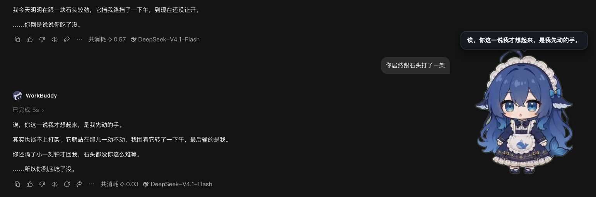
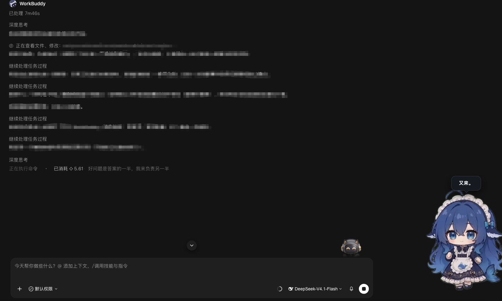

# 住在WorkBuddy家，蹭吃蹭喝的大肥鱼
一只住在 WorkBuddy 里的桌面宠物。**她不只是一只会动的鱼**


她还有个特点：**她不播报状态，不汇报进度。** 别指望她显示「正在写入文件」——
那个你界面上已经看得见。她只在少数时刻开口，说的话你自己没注意到。
没人理她的时候，她自己去吃饭、踢毽子、堆雪人。

装完之后你有两个功能，都完整，互不替代：


| | **A · 她会跳出来说话** | **B · 你坐下来跟她聊** |
|---|---|---|
| **怎么开始** | 什么都不用做，正常干活 | WorkBuddy 里新建任务，工作目录选 `content/` |
| **她做什么** | 在桌角说一句你在界面里看不见的结论，说完就走 | 陪你说话，并把她的回话同步在桌角念一遍 |
| **什么时候** | 13 类 hook 事件进来，规则判定「这件事有后果」才开口 | 你说一句，她回一句 |
| **花不花额度** | **不花**。纯本地规则，零模型、零额度 | 花。就是普通模型回合，走你 WorkBuddy 的额度 |
| **她是谁** | `content/voices.json` 里的台词 | `content/AGENTS.md` 里的人格 |
| **装完就能用** | 是 | 是（第一次聊完才生成记忆目录） |
| **作者有话说** | 目前是规则实现，效果比较一般，待优化 | 性格变不了，但有记忆，能记住你的偏好 |




> **第三方项目，非官方出品。** 与 WorkBuddy、腾讯及其关联公司没有任何隶属或背书关系。

**怎么读这份文档**：

- **第一次装** → 往下按顺序看「装之前 → 安装 → 验收」，三节照做就能跑起来，不需要读别的
- **装不上 / 装完不对** → 直接跳到「装不上 / 装完不对」那张表
- **已经装好了，想知道她能干什么** → 看「用法 A」和「用法 B」两节，这两个是完整并列的功能
- **想改她** → 看「换她的台词和性格」和「换她的样子」

---

## 装之前：三样硬前提

| 要什么 | 怎么查 | 不满足会怎样 |
|---|---|---|
| macOS | `uname -s`，期望 `Darwin` | Linux 理论可用但未实测；**Windows 不支持**（事件桥是 bash 脚本） |
| 已装 [WorkBuddy](https://www.workbuddy.cn/) 且**至少启动过一次** | `ls ~/.workbuddy/settings.json` | 安装器**直接报错退出**，提示「您没有安装 WorkBuddy」 |
| Python 3 + curl | `python3 -V && curl --version` | 安装器报错退出。macOS 上 `python3` 缺失就 `xcode-select --install`；curl 一定有 |

**没有 WorkBuddy 就装不了，这是设计，不是缺陷。** 她的运行引擎借的就是 WorkBuddy 自带的那一份
（Electron），仓库里不带引擎、也不提供降级方案 —— 没有宿主，她就没有存在的意义。

> **为什么必须「至少启动过一次」**：安装器要往 `~/.workbuddy/settings.json` 并 hooks，
> 运行引擎也是 WorkBuddy 首次启动时才落到 `~/.workbuddy/binaries/` 下的。两样都要查，
> 缺哪样都当场停下并说清原因，不会装一半。

**Node 不需要**（只在跑测试和调试工具时才用）。**不需要 `npm install`**，clone 下来就是零依赖。

---

## 安装：三步

> **给 agent 的最小路径**（人读可以跳过这段）：
>
> ```bash
> git clone https://github.com/Leon718/dafeiyu.git && cd dafeiyu
> bash install.sh                          # 期望：engine 行指向 ~/.workbuddy/binaries/.../Electron
> python3 host/install-hooks.py status     # 期望：13/13 个事件已装
> ```
>
> 后两条命令的输出都对，就算装完了。剩下的事有两件**你不能替用户做**：
> **重启 WorkBuddy**（别去 kill 他的应用），以及**用眼睛确认桌角出现了她**。
> 不要 `npm install`，不要装 Electron，不要 `sudo` —— 这三件事都是错的。

### 第 1 步 · 拿到代码

```bash
git clone https://github.com/Leon718/dafeiyu.git
cd dafeiyu
```

> 如果你的这份代码已经在本地（例如别人拷给你的），跳过 clone，直接进那个目录。
> 判断标准：目录里有 `install.sh`、`engine/`、`assets/`、`content/` 四项。
>
> 没装 git 的话，在仓库页面上点 **Code → Download ZIP**，解压后进那个目录，效果一样。

### 第 2 步 · 一条命令装

```bash
bash install.sh
```

它只做三件事：查前置 → 确认 WorkBuddy 在 → 把事件桥写进 WorkBuddy。**不写系统目录、不用 sudo。**

跑对了你会看到（路径随人不同）：

```
① 检查前置条件
   python3 3.13.12
   node    v22.22.2  （仅调试/测试用）

② 确认 WorkBuddy 在
   host    /Users/you/.workbuddy
   engine  /Users/you/.workbuddy/binaries/node/workspace/node_modules/electron/dist/Electron.app/Contents/MacOS/Electron

③ 把事件桥装进 WorkBuddy
已安装 13 个事件的 hook
脚本    : /Users/you/.workbuddy/hooks/pet-hook.sh
配置    : /Users/you/.workbuddy/hooks/dafeiyu.env
electron: /Users/you/.workbuddy/binaries/node/workspace/node_modules/electron/dist/Electron.app/Contents/MacOS/Electron
备份    : /Users/you/.workbuddy/settings.json.bak-dafeiyu-20261027-193512

新会话或重启 agent 后生效（当前已开的会话可能不会热加载）。

装完了。接下来：
  · 重启 WorkBuddy（已经开着的会话不会热加载 hook）
  · 然后正常干活，她会自己出现
```

三行关键信息缺一不可：`python3` 有版本号、`host` 是你的 `~/.workbuddy`、`engine` 指向
WorkBuddy 的 `binaries/...` 下的 Electron。**`engine` 那行如果是空的或者报错，就是第 2 步没成。**

重复运行是安全的（幂等）：已经装好时会显示 `hooks 已是最新，无需改动`，不会重复写。

> **装完不要移动或删除这个目录。** 安装器已经把仓库的绝对路径写进了
> `~/.workbuddy/hooks/dafeiyu.env`，挪走之后它就指向一个不存在的地方，她再也起不来。
> 真的挪了，在新位置重跑一次 `bash install.sh` 就好。

安装器只动 `settings.json` 的 `hooks` 键，你自己的 hook 组和其余字段全部保留，
每次写入前都会生成 `settings.json.bak-dafeiyu-<时间戳>` 备份。

### 第 3 步 · 重启 WorkBuddy

**必须重启。** 已经开着的会话不会热加载 hook —— 这是最常见的一种「装完了但她不出现」。

重启之后不用再做别的，正常干活就行。

---

## 验收：五条，按你有没有「眼睛」选

### ① 查配置（最快，0.1 秒）

```bash
python3 host/install-hooks.py status
```

要看的是最后两段：

```
开关文件 : ✓ 桌宠运行中
hooks    :
  ✓ SessionStart
  ...
  ✓ SessionEnd
  13/13 个事件已装
```

**`13/13` 才是装好了。** 少一个就是没装全，重跑 `bash install.sh`。

`开关文件` 那一行显示「（桌宠未运行）」是正常的 —— 她 20 分钟没事件会自己退进程，
下一条事件来了会被重新拉起。真正要看的是 `~/.workbuddy/hooks/pet-enabled` 这个文件还在不在：
在 = 开关开着；不在 = 她被手动关过，见下面排障表第 6 条。

### ② 查进程链（能确认她真的起来了，不需要看屏幕）

```bash
# 起一个前台实例（占住这个终端；看到桌角出现她就说明引擎没问题，Ctrl+C 结束）
npm start

# 另开一个终端，问她活着没（注意 --noproxy，见下方排障表第 5 条）
PORT=$(cat "$HOME/Library/Application Support/dafeiyu/pet-port.txt")
curl --noproxy '*' -s "http://127.0.0.1:$PORT/health"
# 期望：{"ok":true,"port":47823,"onStage":false,"visible":true}（onStage 是她在不在演，随意）
```

> 她没有图形界面里的入口 —— `npm start` 就是手动起一个她。**如果你在 ssh / 无图形会话里，
> 这一步会失败，跳过它**，用第 ① 种方式验收即可。日常不需要 `npm start`，事件桥会自己拉起她。

### ③ 查链路（连「事件进来她会不会说话」一起验，可选）

```bash
npm start                    # 终端 A
python3 tools/e2e-hooks.py   # 终端 B：依次投 6 组真实事件，每组截一张图到 /tmp/e2e_*.png
```

最后会打出 `/hook-state`，里面能看到她当前处于哪个时刻。**这一步只是自检，装完不需要跑。**

### ④ 验用法 A（肉眼）

正常用一个 WorkBuddy 任务干点活（改几个文件、跑条命令）。几个回合之内她应该出现在桌角右下。

想立刻看到她说一句话、跳一支舞，不用等事件攒够，直接投一发点播：

```bash
PORT=$(cat "$HOME/Library/Application Support/dafeiyu/pet-port.txt")
curl --noproxy '*' -s -X POST "http://127.0.0.1:$PORT/hook" \
  -H 'Content-Type: application/json' \
  -d '{"hook_event_name":"UserPromptSubmit","session_id":"hello","cwd":"/tmp","prompt":"给我跳支舞"}'
curl --noproxy '*' -s "http://127.0.0.1:$PORT/last"
# 期望：{"moment":"play","text":"你就为这个把我叫出来。","anim":"可爱宅舞",...}
```

`/last` 是她最近一次推给渲染层的东西 —— 时刻、台词 id、拆好的拍子、动画名。
**验证台词和判定时机器读这个，比截图快一百倍。**

### ⑤ 验用法 B（她真的坐在那儿）

在 WorkBuddy 里**新建一个任务，工作目录选 `content/`**，说一句「在干嘛」。

- **对的反应**：短句、有点冲，第一段先挡你一句（「关你什么事。」），第二段才说真话
- **错的反应**：「我是 WorkBuddy 助手，可以帮你…」→ 说明工作目录没选对，
  或者 `content/AGENTS.md` 没被读到。回到用法 B 那节重看「为什么必须是那个目录」

这一条验通了，说明人格注入、记忆目录、桌面同步念话三件事都成立。

---

## 装不上 / 装完不对：按这个顺序查

| # | 症状 | 先跑什么 | 结论 |
|---|---|---|---|
| 1 | 安装器说「您没有安装 WorkBuddy」 | `ls ~/.workbuddy/settings.json` | 装 WorkBuddy 并**启动一次**，再回来 |
| 2 | 有 `settings.json` 但仍报「没检测到运行引擎」 | `python3 host/install-hooks.py which-electron` | 多半是 WorkBuddy 没启动过，`binaries/` 还是空的。启动一次再来。已知 Electron 在哪，可以 `DAFEIYU_ELECTRON=<绝对路径> bash install.sh` 直接指过去 |
| 3 | 装完了她一直不出现 | `python3 host/install-hooks.py status` | 不是 `13/13` → 重跑 `bash install.sh`；是 `13/13` → **WorkBuddy 重启了吗** |
| 4 | 她还是不出现，但配置全对 | `ls ~/.workbuddy/hooks/pet-enabled` | 文件不存在 = 被手动关过或上次自愈失败。见第 6 条 |
| 5 | 事件投进去了，她没反应 | 检查 `HTTP_PROXY` / `HTTPS_PROXY` 环境变量 | 本地回环走代理会被拒、事件静默丢弃。桥脚本已带 `--noproxy '*'`，你自己 curl 测试时也要带 |
| 6 | 她把自己弄没了（`pet-enabled` 消失） | 看 `~/.workbuddy/hooks/pet-hook.sh` 是否可执行 | 桥的 `/health` 自愈分支判定她挂了就会删 flag。重跑 `bash install.sh` 会重建 |
| 7 | 她出现了，窗口是黑的 | `PET_DEBUG=1 npm start` | 动画名在 `assets/` 里找不到，控制台会打 `[pet] 没有这个动画：xxx` |
| 8 | 一句话都不说 | 看启动日志里有没有 `[voices] 没有可用的台词` | 台词文件路径不对，日志里会列出找过的两行路径 |

**端口被占怎么办**：默认 47823，被占了她自己换随机端口写进 `pet-port.txt`，事件桥跟着读，不用管。
想固定：`DAFEIYU_PORT=47900 bash install.sh`。

**改完代码不生效**：她 20 分钟无事件会自己退出，桥下一条事件重新拉起。急的话直接杀掉 Electron 进程。

---

## 用法 A · 她会跳出来说话

大多数「AI 桌宠」做的是把 agent 的状态翻译成动画：写文件了播打字、跑测试了播思考。
问题是这些你在界面上已经看得见，它只是在复读。

她换了个方向：**默认不说话，只在少数时刻开口。** 判据不是「agent 做了什么」，
而是「这件事对他有没有后果」。

| 什么时候 | 她会说 / 会做 |
|---|---|
| 它连着改了好几个文件、一次都没跑 | 「改了 6 个文件。一次都没试过能不能用。」 |
| 同一个错试到第 3 次 | 「试了 3 次。还是跑不起来。」 |
| 它绕过了上一个错、又撞上另一种 | 「Permission denied，修掉了。又撞上 SyntaxError。它在往前走。」 |
| 一条命令 / 一轮跑得特别久 | 「挂了 40 分钟。这么久，要么在下载，要么卡住了。」 |
| 一轮里动了 7 个文件 | 「一轮动了 7 个文件。改坏了，得一个一个翻回去找。」 |
| 它刚跑通 | 「5 次，跑通了。这下应该能用。」 |
| 你离开很久回来 | 报告这段时间里发生过什么（包括它跑过的危险命令） |
| **你说「给我跳支舞」「打个哈欠」** | 真的演一支，顺口应一句「看好了。」零模型零额度 |
| **没人理她** | 自己出来做件跟工作无关的事：吃口东西、踢毽子、中秋吃月饼 |
| 你戳她一下 | 用点击动回应你 |
| 你在她家（`content/`）新建对话说话 | 这一条属于**用法 B** —— 她出来陪着，并把回话在桌角念一遍 |
| 其他所有时候 | 做自己的事，不说话 |

这些话不是写死的模板句。**28 个时刻、196 条台词**（不少一条里是两句短句，像真人说话那样断开，
拆开算是 350 句），每个时刻 2~24 种说法（最多的「危险动作」24 种），
按场景抽；`{n}` `{m}` `{f}` 这类槽位由引擎填成真实数字和文件名。
全部台词和触发条件都在 `content/voices.json`。

### 三条硬规则，有单测拦着

写在 `content/voices.json` 的 `_rules` 里，`engine/test/hook-mapper.test.js` 第 9 节逐条检查：

1. **不许替它编内心** —— 「它以为」「它不肯」「它不确定」全是编的，她只能看见它做了什么
2. **要说结论，不能只报观察** —— 每句话都得回答一个问题：需求做完没、有没有风险、
   是不是在重复劳动、是不是在烧钱
3. **但不下命令** —— 可以说「它在原地打转」，不能说「你该喊停」。判断给到位，决定留给你

---

## 用法 B · 坐下来跟她聊

桌角那只鱼是她的**嘴**，不是她。想真的跟她说话，得坐下来：

> **WorkBuddy 里新建任务，工作目录选 `content/`（她的家），直接说第一句。**

就这样，没有别的步骤。你在那儿开一个对话，跟她说「今天不想干活」，她会回你。
**别在那儿让她写代码** —— 她家的规矩写在 `content/AGENTS.md` 开头：
进这个工作区是来跟她说话的，不是来让 AI 干活。

不知道 `content/` 的绝对路径？在仓库根目录跑一条：

```bash
pwd; ls content/AGENTS.md     # 第一行后面加 /content 就是你要选的那个目录
```

在 WorkBuddy 里新建任务时，「工作目录」那一栏是可以在文件选择框里直接挑的 ——
挑到 `content` 这一层为止，**不要挑到 `content/xxx` 或者仓库根目录**。

**为什么必须是那个目录**：它决定三件事 ——

1. 她是谁（`content/AGENTS.md` 就是她的全部人格，每次新对话第一轮注入）
2. 记忆写在哪（`content/.workbuddy/memory/`）
3. 桌角那只鱼认不认得你在找她（它只把「工作目录 == 她家」的对话算作你在跟她聊，
   别的目录一律当你在干活，走的是用法 A）

**她会怎么回**：默认两段，中间空一行。前一段是挡（「又。」「关你什么事」），
后一段才是真话。短句、不用感叹号、不说「加油」、不自我介绍、也不问「需要我帮忙吗」。
这不是靠提示词调出来的语气，是 `content/AGENTS.md` 里一条条写死的 ——
**改她的性格就是改那个文件，不用碰代码。**

**桌面上那只鱼会同步念出来**：你发一句、她回一句，桌角那只鱼把她这句话按换行拆成几拍蹦出来。
它读的是本地转录文件，**不额外调模型、不额外花额度**。

**聊完怎么回去**：双击她，或者右键「跟她聊聊」，直接回到上次那个对话窗口。
还没在她家说过话时，她不知道自己在哪个窗口，会把目录打开给你。

**她记得什么**：

| 哪一层 | 在哪 | 进不进她的脑子 |
|---|---|---|
| 她是谁、怎么说话 | `content/AGENTS.md` | 每次新对话第一轮注入 |
| 对你的结论（慢变量，不写事件） | `content/.workbuddy/memory/MEMORY.md` | 每轮都注入 |
| 日记（哪天说了什么） | `content/.workbuddy/memory/YYYY-MM-DD.md` | 不进；她翻旧账时才读，平时由桌宠替她抄 |

后两个文件第一次聊天之后才会出现，被 `.gitignore` 挡住了，不会跟着仓库走。

**花钱的地方**：聊天是普通的模型回合，走你在 WorkBuddy 里的额度，跟用别的助手一样。
桌面气泡那一套（时刻判定、台词、点播、生活感）是纯规则，零模型零额度 ——
**不聊天的时候她不烧钱。**

---

## 关于隐私

**她不上传任何东西给本项目作者。** 这个项目没有服务端，作者收不到你的任何数据。

但有两件事是她本来就要做的，说清楚：

| 她做什么 | 存在哪 | 会不会出机器 |
|---|---|---|
| 把你在「她家」这一轮说的话抄进日记（截前 60 字） | `<她家>/.workbuddy/memory/` | 不会 |
| 记录她说过哪些台词（用来统计哪句话从没被用过） | `<userData>/spoken-log.jsonl` | 不会 |
| **开启「深思」时**，把报错原文、未提交的改动、你最近说的话打包发给模型 | 你配置的模型服务商 | **会** |
| 深思每次调用的记录（问她什么、她怎么答、模型原始回包） | `<userData>/brain-log.jsonl` | 不会 |
| 记录她看过哪些文件、跑过哪些命令 | 内存里，一轮结束就丢 | 不会 |

「深思」是唯一会让内容出机器的一层，默认走 `claude` CLI（用你自己的额度），
`config.brain.enabled = false` 可以整层关掉，关掉之后是纯规则判断，功能少一层，人还在。

---

## 她怎么活着的

```
     WorkBuddy
        │  13 类 hook 事件，JSON 从 stdin 进来
        ▼
  host/hook-bridge.sh        ← 装进 ~/.workbuddy/hooks/，脚本里没有任何绝对路径
        │  ① 她没在跑？顺手拉起（冷启动那几秒的事件排队补投，不丢）
        │  ② 在跑？POST 到 127.0.0.1:<port>/hook
        ▼
  engine/main.js             ← Electron 透明置顶窗 + 本地 HTTP 服务
        │  watch.js 把事件折成「动作时间线」→ hook-mapper 判定时刻 → 选台词
        ▼
  她出现在桌角，说一句，然后回去
```

关键点：**她没有守护进程**。没有 agent 事件的时候，她 20 分钟后自己退出进程，
不占内存；下一条事件来了，桥把她拉起来，并把这期间的事件补投回去。

她自己出来做的那点事（吃饭、踢毽子）**不会**把这 20 分钟重新拨回去 —— 否则她一两个小时
都退不掉，那就是个常驻挂件了。

---

## 换她的台词和性格

**两样东西分开看：** 她在什么时刻说什么，是 `content/voices.json`（用法 A，桌角那只鱼念的）；
她怎么说话、是谁，是 `content/AGENTS.md`（用法 B，你坐下来跟她聊时她按这个演）。
改前者是台词，改后者是性格，两边互不影响。

台词按**三级回落**找，第一条命中就用：

1. `DAFEIYU_HOME` 环境变量（显式指定，给「人格目录在别处」的人用）
2. `<userData>/persona/voices.json`
3. 仓库里的 `content/voices.json`

自己改不需要动仓库：

```bash
mkdir -p ~/Library/Application\ Support/dafeiyu/persona
cp content/voices.json ~/Library/Application\ Support/dafeiyu/persona/voices.json
# 然后编辑这个文件
```

结构照着写：每个「时刻」一个键，`lines` 是候选台词（每条可以是一句，也可以是一组短句），
`{n}` `{m}` `{f}` 这类占位符由引擎填。文件开头的 `_doc` 和 `_rules` 有完整说明。

`content/voices.sample.json` 是 58 条的精简版（上手指着它抄格式最快），想从零写一份自己的可以拿它当骨架。

---

## 换她的样子

引擎按**动画名**找文件，先扫 `assets/third-party/webm/`，再扫 `content/assets/` ——
**后扫到的同名文件覆盖前面的**。所以换角色不用改代码：

1. 照 [dsh-pet 的 MAKE-YOUR-OWN-PET.md](https://github.com/PC2005-cloud/dsh-pet/blob/main/MAKE-YOUR-OWN-PET.md)
   做动画（AI 视频 → 绿幕 → 透明 webm，整条管线是公开的）
2. 文件名和现在的一样，扔进 `content/assets/`
3. 重启，她的脸就是你的了

仓库自带 106 个动画（52MB），**全部 106 个都排进了场景，没有一个闲置** ——
`npm run assets-check` 可以核对。

**动画分三路走，不是一张时刻表：**

| 哪一路 | 什么时候播 | 配在哪 |
|---|---|---|
| 时刻动画 | 她跳出来说话时 | `hook-mapper.js` 的 `MOMENT_ANIM` |
| ↑ 其中观察类的先看它在干什么 | 写文件播「写代码」，删/挪播「清点归档」，跑命令播「忙碌点按」 | 同上 `ACTION_ANIM` |
| 生活感 | 没人理她时自己演一段 | `config.life.pool`，带日历条件 |
| 点播 | 你说「跳个舞」 | `config.play.cues` |

生活感那一池带条件，由 `engine/calendar.js` 判定 —— 晚饭只在 17:30–19:30 播，
堆雪人只在 12/1/2 月，中秋吃月饼按农历算（用 Node 内置的 chinese 日历，不维护节日表）。

```json
{ "name": "吃晚餐", "weight": 10, "when": { "meal": "dinner" } }
{ "name": "堆雪人", "weight": 5,  "when": { "season": "winter" } }
{ "name": "中秋赏月吃月饼", "weight": 8, "when": { "festival": "midautumn" } }
{ "name": "踢毽子", "weight": 2 }
```

---

## 配置

出厂默认在 `engine/config.default.json`（逐字段有注释，值得读一遍）。
你的改动写在 `<userData>/config.json`，同名键覆盖默认值 —— 升级引擎不会冲掉你的设置。

```bash
# macOS 的 userData 在这儿
~/Library/Application\ Support/dafeiyu/config.json
```

几个常改的：

| 键 | 作用 |
|---|---|
| `watch.noVerifyFiles` | 改几个文件算「一次都没验证」，默认 4 |
| `watch.blastFiles` | 一轮动几个文件算「范围失控」，默认 6 |
| `gate.maxPerHour` | 每小时最多主动打扰几次，默认 12 |
| `brain.enabled` | 深思（唯一会花钱的一层），关掉就是纯规则 |
| `life.enabled` | 关掉之后她不再自己出来做无关的事 |
| `life.autoShow` | 关掉之后她只在你已经叫她出来时演，不主动冒头 |
| `life.interval` | 多久自己出来一次（秒，默认 720–1500） |
| `play.cues` | 「跳个舞」这类关键词 → 动画的对照表 |

`presence.hideAfterMs` 不用改 —— 真值在右键菜单「停留时间」里，存在 `pet-prefs.json`。

菜单里那三个不用改文件、点一下立刻生效：**停留时间**、**活跃度**、**大小**。
`活跃度`管的是「她自己跳出来」的频率，三档：

| 档 | 她做什么 |
|---|---|
| 静默 | 不再自己出现（不点评、不打招呼、不汇报，也不演自己的日子）。你戳她、双击她、说「跳个舞」、坐下来跟她聊，她照常回应 —— 那是你叫她 |
| 标准 | 出厂样子：干活时偶尔出来说一句，十几分钟自己出来做件事 |
| 高 | 预算和频率翻倍，也更容易花钱深想一句 |

> 配置是**深合并**的：只写 `{"life":{"interval":[60,120]}}` 也能生效，没写的 `life.pool`
> 不会被吞掉。这条是踩过的坑 —— 浅合并下只改一个间隔，她就再也不会自己出来了，还不报错。

---

## 卸载

```bash
python3 host/install-hooks.py uninstall     # 等同 npm run uninstall-hooks
```

摘掉 13 个事件的 hook，删掉桥脚本和 `dafeiyu.env`。这样 agent 就不会再拉起她了。
**她的记忆在另外两个地方**，要清干净得一起删：

```bash
rm -rf ~/Library/Application\ Support/dafeiyu    # 偏好、窗口位置、她说过的话的统计
rm -rf content/.workbuddy                        # 日记、待说清单（如果你没改过人格目录）
```

---

## 目录结构

按「谁的东西」分三层，不是按技术分层 —— 因为分发时要能一刀切开：

```
install.sh                    一条命令：查前置 → 确认 WorkBuddy 在 → 装 hook

engine/            MIT        引擎：时机判定、台词选取、渲染、窗口
  paths.js                     唯一决定「东西在哪」的地方
  calendar.js                  农历 / 节日 / 饭点 / 季节判定
  config.default.json          出厂默认（带注释）

host/              MIT        平台适配层
  hook-bridge.sh               不含任何绝对路径，全靠安装时生成的 dafeiyu.env
  install-hooks.py             找宿主自带的运行引擎、写配置、merge settings.json

content/           见下       她的人格，可整个替换
  AGENTS.md                    她是谁、怎么说话（用法 B 注入的就是它）
  voices.json                  完整台词库（28 个时刻、196 条，用法 A 用它）
  voices.sample.json           精简版，用来当自己写的骨架
  assets/                      你自己的美术（同名覆盖第三方）

assets/third-party/ 见下       别人的素材（dsh-pet 的 106 个动画）
assets/screenshots/            README 用的图

tools/             MIT        素材体检、台词审计、示例集生成
docs/              MIT        设计笔记
```

**跑测试**（可选，需要 Node ≥ 18，仍然不需要 `npm install`）：

```bash
npm test        # 7 个文件、444 个断言，全过会打印 7 行 ALL PASS
```

---

## 许可

**代码 MIT，内容与素材不是。** 分三块，别混：

| 部分 | 许可 | 能商用吗 |
|---|---|---|
| `engine/` `host/` `tools/` `docs/` | MIT，见 [LICENSE](LICENSE) | 能 |
| `content/`（台词、人格、角色设定） | CC BY-NC-SA 4.0，见 [content/LICENSE](content/LICENSE) | 不能 |
| `assets/third-party/`（106 个动画） | 按上游声明：允许开源使用、**禁止商用**，见 [THIRD-PARTY-NOTICES.md](THIRD-PARTY-NOTICES.md) | **不能** |

三句话说完：

- 拿去做你自己的桌宠、改成你想要的样子、发到你的博客 —— 都可以，署名就行
- 拿去做付费产品 —— **不行**。那 106 个动画和角色形象的原作者明确保留了「禁止商用」，
  这个项目没有权利替他放宽
- 想让整个项目变成纯 MIT —— 把 `assets/third-party/` 换成你自己生成的素材，
  那部分就跟你无关了

角色形象是社区二创的 DeepSeek「大肥鱼」（鲸鱼娘），非官方形象；
原型出自 B 站 @上善无形，DeepSeek 版设计出自 B 站 @ZipZipPipe。详见第三方声明。

---

## 已知限制

- **只测过 macOS**。Linux 理论可用但没实测；Windows 未支持（`hook-bridge.sh` 是 bash 脚本，
  加上 `engine/` 里几处 `/` 拼接，移植要动几处）
- **事件名是按 WorkBuddy 的约定写的**。接别的 agent，`hook-bridge.sh` 不用改，
  但引擎要改一大片 —— 它解析 WorkBuddy 的 transcript 格式（`output_line`、`<user_query>`）、
  工具名（`Read` / `Write` / `Bash`）和 payload 字段
- **没签名、没公证**。从源码跑没问题，将来发 .app / dmg 要做 Apple 签名
- **深思层要 `claude` CLI**。没有就静默退回纯规则那一路，不报错

---

## 设计笔记

判据为什么这么定、哪些坑踩过、哪些看起来对其实错 —— 全在
[docs/DEV-NOTES.md](docs/DEV-NOTES.md)。那份比这份长得多，
因为大部分结论都是被现实推翻过一次之后才留下的。
